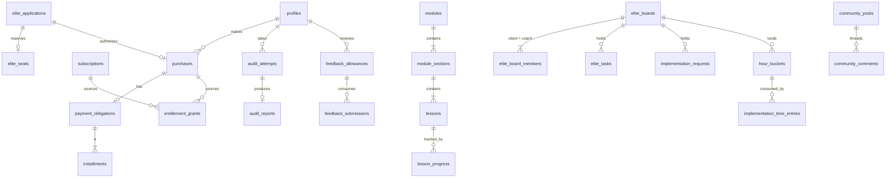

> **SUPERSEDED IN PART (2026-11-01).** This draft was written before the finalized handoff package arrived. Where it differs, these win: `docs/handoff/FINAL_DECISIONS_REGISTER.md`, `docs/handoff/HANDOFF_SPECS.md`, `docs/phase2/PHASE2_CANONICAL_SOURCES.md`. Known differences: roles are `student`, `coach`, `admin` (D09); email vendor is Resend (D03); analytics is Vercel Analytics (D03); fonts are Cormorant Garamond and DM Sans (D01); audit has 8 categories and 30 fixed questions (Phase 2); feature keys follow HANDOFF_SPECS section 03; the app lives in `portal/`. The as-built design is tracked in `docs/BUILD_STATUS.md` and `docs/IMPLEMENTATION_ISSUES.md`.

# DATA_MODEL.md
# Database Entity Map

_Status: DRAFT for owner review. Conceptual design, not yet migrations. Every table has `id uuid pk`, `created_at`, `updated_at` unless noted. Member-owned tables also have `deleted_at` (soft delete). RLS is enabled on every table with deny-by-default._

Schemas: `public` (app tables, RLS), `app` (security definer functions), `private` (server-only tables with no client grants: webhook payloads, outbox, job runs).

The CLAUDE.md conceptual entity list is fully covered. Where entities were consolidated, the mapping is shown in section 12.

---

## 1. Identity and access

| Table | Key columns | Relationships / constraints |
|---|---|---|
| `profiles` | `user_id` (pk, fk auth.users), display_name, avatar_path, timezone, accessibility_prefs jsonb, onboarding_state, selected_path (`build_from_scratch` / `optimize_automate` / null) | 1:1 auth.users |
| `staff_roles` | user_id, role enum(`coach`,`support_admin`,`super_admin`), granted_by, revoked_at | unique active (user_id, role) |
| `entitlement_grants` | user_id, grant_key enum, starts_at, ends_at, status enum(`active`,`suspended`,`revoked`), source_type (`purchase`/`subscription`/`manual`/`bonus`), source_id, reason | check `ends_at > starts_at`; manual grants require reason + actor |
| `grant_status_events` | grant_id, from_status, to_status, cause (`grace_expired`,`cured`,`refund_initiated`,`admin`), actor, occurred_at | append-only |
| `notification_preferences` | user_id, channel (`portal`,`email`), topic, enabled | unique (user_id, channel, topic) |

## 2. Commerce

| Table | Key columns | Notes |
|---|---|---|
| `products` | key (`blueprint`,`accelerator`,`elite`,`graduate`,`elite_board`,`dfy_3`,`dfy_5`,`dfy_10`), name, kind (`program`,`subscription`,`hours_package`), requires_application bool | Seeded from config |
| `pricing_plans` | product_id, plan_kind (`pif`,`installments_6`,`monthly`,`one_time`), amount_cents, currency, installment_count, env, stripe_price_id, active | Stripe IDs per environment, never hardcoded in source |
| `stripe_customers` | user_id, stripe_customer_id, env | unique |
| `purchases` | user_id, product_id, pricing_plan_id, status, enrolled_at, stripe_checkout_session_id, stripe_subscription_id / payment_intent_id, elite_application_id (nullable), bonus_window_id (nullable), refund_status | unique checkout session id |
| `payment_obligations` | purchase_id, total_installments (6), paid_installments, status (state machine in ENTITLEMENTS 5.2), grace_started_at, suspended_at, stripe_subscription_schedule_id | check `paid_installments <= total_installments` |
| `installments` | obligation_id, sequence 1..6, stripe_invoice_id, due_at, status (`scheduled`,`paid`,`failed`,`void`,`refunded`), paid_at, attempt_count | unique (obligation_id, sequence), unique stripe_invoice_id |
| `subscriptions` | user_id, product_id, stripe_subscription_id, status, current_period_start, current_period_end, cancel_at_period_end, canceled_at | |
| `payment_events` | user_id, purchase_id, kind (charge, refund, dispute), amount_cents, stripe_object_id, occurred_at | Read model for admin billing |
| `bonus_windows` | name (Launch Kit), starts_at, ends_at, published_at, eligible_products | grant only if purchase `enrolled_at` in window AND window published |
| `refund_requests` | purchase_id, user_id, submitted_via (`portal`,`email`), reason, evidence jsonb (onboarding/audit/assignment timestamps auto-captured), status (`submitted`,`needs_info`,`approved`,`denied`,`initiated`,`completed`), review_due_at (3 business days), reviewed_by, decision_note | |

## 3. Elite application and capacity

| Table | Key columns | Notes |
|---|---|---|
| `elite_applications` | user_id (nullable until account), email, answers jsonb (versioned form), status, discovery_at, approved_by, approved_at, approval_expires_at, decline_reason | |
| `elite_seats` | application_id, user_id, status (`reserved`,`active`,`released`), reserved_until, activated_at, released_at | Seat count enforced in a transaction with an advisory lock; partial unique index guards |

## 4. Onboarding and audit

| Table | Key columns | Notes |
|---|---|---|
| `audit_question_sets` | version (semver), status (`draft`,`published`,`retired`), scoring_config jsonb, published_at | Immutable once published |
| `audit_questions` | question_set_id, category (10 enum values), order, prompt, answer_type, options jsonb, weight | |
| `audit_attempts` (= audit_responses container) | user_id, question_set_id, status (`draft`,`submitted`), started_at, submitted_at | Resume draft |
| `audit_answers` (= audit_responses) | attempt_id, question_id, value jsonb | unique (attempt_id, question_id) |
| `audit_reports` | attempt_id, user_id, question_set_version, category_scores jsonb (= audit_scores), strengths, gaps, top_priorities, recommended_path, recommended_modules, roadmap jsonb, generated_at | Deterministic from answers + config version; regenerable |
| `onboarding_checklist_items` / `member_onboarding` | item key, user_id, completed_at | Also feeds refund evidence |

## 5. Curriculum and learning

| Table | Key columns | Notes |
|---|---|---|
| `phases` | key (`build`,`optimize`,`systemize`,`sell`), order | Fixed 4 |
| `modules` | number 1..8, title, phase_id, outcome, deliverable, status | Fixed 8 per blueprint |
| `module_sections` | module_id, title, order | |
| `lessons` | section_id, slug, title, duration_seconds, video_asset_id, transcript (markdown), body (markdown), status (`draft`,`published`), published_at | |
| `lesson_resources` | lesson_id, kind (`download`,`template`,`library_link`,`external`), storage_path or url, title | |
| `learning_paths` | key (`build_from_scratch`,`optimize_automate`), name | |
| `learning_path_steps` | path_id, module_id or lesson_id, order, suggested_month (1..6) | Same content, different ordering |
| `lesson_progress` | user_id, lesson_id, completed_at | unique (user_id, lesson_id) |
| `assignments` | lesson_id or module_id, prompt, evidence_kind | |
| `assignment_submissions` | assignment_id, user_id, note, link_url, attachment_id, submitted_at | Self-marked, never "reviewed" |
| `milestones` | module_id, title, order | |
| `member_milestones` | user_id, milestone_id, completed_at, evidence_link, attachment_id | |
| `library_items` | type (`tutorial`,`recipe`,`prompt`,`template`,`walkthrough`,`troubleshooting`), title, body, tags, tools, cost_note, search_vector | |
| `lesson_library_links` | lesson_id, library_item_id | |
| `ai_assistant_resources` | provider (`chatgpt`,`claude`), title, external_url, instructions, prompt_template | External links only |
| `member_prompt_templates` | user_id, source_resource_id, body | Member's editable copy |
| `video_assets` | provider, provider_asset_id, playback_policy (`signed`), captions_status, duration | |

## 6. Coaching, workshops, Hot Seat

| Table | Key columns | Notes |
|---|---|---|
| `coaching_sessions` | kind (`group_weekly`,`hot_seat`), starts_at, duration_min (60 / 90), join_url (protected), status | Generated from schedule config |
| `coaching_questions` | session_id, user_id, body, status | Advance questions |
| `session_replays` | session_id, video_asset_id, published_at, consent_verified bool | Hot Seat replay requires consent check |
| `hot_seat_applications` | user_id, target_month, topic, details, status (`submitted`,`selected`,`not_selected_carried`,`withdrawn`), carried_from_id, notified_at | Edit/withdraw while not closed |
| `hot_seat_consents` | application_id, user_id, consent_text_version, consented_at, redaction_requests | Explicit, versioned |
| `workshops` | title, description, video_asset_id, duration, resources | |
| `workshop_releases` | workshop_id, release_at (first/third Monday), status | |
| `private_sessions` | elite_user_id, starts_at, status (`scheduled`,`completed`,`late_cancel_forfeit`,`no_show_forfeit`,`coach_canceled`,`replacement`), replaces_session_id | Elite weekly 1:1 |

## 7. Community

| Table | Key columns | Notes |
|---|---|---|
| `community_posts` | author_id, title, body (markdown, sanitized on render), tags, pinned_at, is_announcement, status (`visible`,`hidden`,`removed`), search_vector | |
| `community_comments` | post_id, parent_comment_id (threaded), author_id, body, status | depth limit enforced |
| `reactions` | target_type, target_id, user_id, kind (`like`) | unique per user/target |
| `content_reports` | target_type, target_id, reporter_id, reason, status, resolved_by | |
| `notifications` | user_id, kind, payload, read_at | Portal notifications |

## 8. Feedback

| Table | Key columns | Notes |
|---|---|---|
| `feedback_allowances` | user_id, cycle_start, cycle_end, granted (2), used | check `used <= granted`, unique (user_id, cycle_start) |
| `feedback_submissions` | user_id, allowance_id, deliverable_title, description, links, status (`submitted`,`in_review`,`responded`), due_at (3 business days), submitted_at | |
| `feedback_responses` | submission_id, coach_id, body, video_asset_id or recording_url, responded_at | |

## 9. Elite boards and DFY

| Table | Key columns | Notes |
|---|---|---|
| `elite_boards` | client_user_id (unique active), status (lifecycle in ENTITLEMENTS 5.5), ended_at, export_window_ends_at, retention_ends_at | |
| `elite_board_members` | board_id, user_id, role (`client`,`coach`) | RLS anchor for board isolation |
| `elite_tasks` | board_id, title, priority, due_at, status, is_deliverable, order | |
| `elite_task_comments` | task_id, author_id, body | |
| `elite_weekly_checkins` | board_id, private_session_id, accomplishments, challenges, top_priorities (3), help_needed, due_at (session - 24h), submitted_at | |
| `elite_audits` | board_id, inputs_complete_at, due_at (7 business days), delivered_at, content jsonb, pdf_attachment_id | Human-conducted |
| `elite_roadmaps` / `elite_roadmap_revisions` | board_id, month, content jsonb, revised_by | Monthly revisions kept |
| `implementation_requests` | board_id, title, scope, estimated_deadline, status (`submitted`,`scoped`,`in_progress`,`completed`,`declined_out_of_scope`), completion_summary | |
| `hour_buckets` (= hour_packages + hour_balances) | board_id, kind (`included`,`package_3`,`package_5`,`package_10`), hours numeric(5,2), starts_at, expires_at, purchase_id | |
| `implementation_time_entries` | request_id, bucket_id, coach_id, hours numeric(5,2), work_date, note, recorded_at | Trigger rejects if bucket sum would exceed |

## 10. Files, privacy, retention

| Table | Key columns | Notes |
|---|---|---|
| `attachments` | owner_user_id, bucket, path, mime_type, size_bytes, context_type, context_id, scan_status | Every storage object has a row; authorization via context |
| `export_requests` | user_id, scope (`account`,`elite_board`), status, file_attachment_id, expires_at | |
| `deletion_requests` | user_id, status, reviewed_by | |
| `retention_events` | subject_type, subject_id, policy_version, action, occurred_at | |

## 11. Audit, events, messaging, analytics

| Table | Key columns | Notes |
|---|---|---|
| `admin_audit_logs` | actor_id, action, target_type, target_id, before jsonb, after jsonb, ip_hash, occurred_at | Append-only (no update/delete grants) |
| `access_audit_logs` | actor_id, subject_user_id, resource_type, resource_id, occurred_at | Staff reads of private member data |
| `private.webhook_events` | provider, event_id (unique), type, payload, received_at, processed_at, status, error, attempts | Idempotency and replay |
| `private.email_outbox` (= email_events) | to_user_id, template, payload, dedupe_key (unique), status, provider_message_id, attempts | |
| `email_suppressions` | email_hash, reason (bounce/complaint/unsubscribe) | |
| `marketing_consents` | email, user_id, source, consent_text_version, consented_at, withdrawn_at | Opt-in proof |
| `masterclass_registrations` | email, name, consent_id, utm jsonb, token_hash, registered_at, first_watched_at | |
| `analytics_events` | anonymous_id, user_id, name, props, occurred_at | First-party funnel events only |
| `support_requests` | user_id, category, body, status | |
| `private.job_runs` | job, idempotency_key (unique), status, started_at, finished_at, error | |
| `private.rate_limits` | bucket_key, window_start, count | |

## 12. Consolidation map from CLAUDE.md conceptual list

| Conceptual entity | Implemented as |
|---|---|
| roles | `staff_roles` (member is implicit for any non-staff user) |
| audit_responses | `audit_attempts` + `audit_answers` |
| audit_scores | `audit_reports.category_scores` (scores are always a function of one report) |
| hour_packages, hour_balances | `hour_buckets` + `implementation_time_entries` (balance is computed, never stored mutable) |
| email_events | `private.email_outbox` + provider webhook updates |
| All others | Same name |

## 13. Relationship overview

